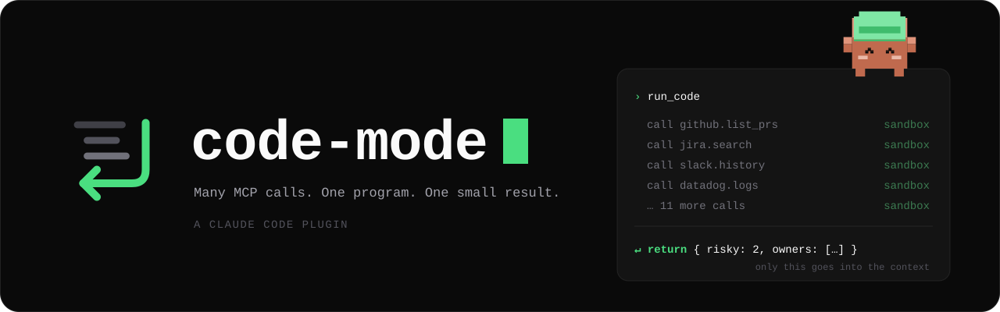

<p align="center">
  
</p>

<h3 align="center">Stop flooding Claude's context with MCP results.</h3>

<p align="center">
  code-mode is a Claude Code plugin. Claude writes <b>one JavaScript program</b> that calls your MCP tools in a sandbox,
  filters and joins the data there, and sends back <b>only the answer</b>.
</p>

<p align="center">
  <a href="LICENSE"></a>
  
  
  <a href="docs/installation.mdx"></a>
  <a href="https://github.com/gabe4coding/claude-code-mode/actions/workflows/test.yml"></a>
</p>

<p align="center">
  <a href="#install-in-30-seconds">Install</a> · <a href="#see-it-in-43-seconds">Demo</a> · <a href="#example">Example</a> ·
  <a href="docs/how-it-works.mdx">How it works</a> · <a href="docs/configuration.mdx">Config</a>
</p>

---

## Install in 30 seconds

Needs Claude Code and Node.js 22.13+. No dependencies. In a Claude Code session:

```
/plugin marketplace add gabe4coding/claude-code-mode
/plugin install code-mode@claude-code-mode
```

Start a new session and ask for anything that needs several MCP calls. Using auto mode? Add allow rules first: [Permissions](docs/permissions.mdx).

## See it in 43 seconds

https://github.com/user-attachments/assets/468c412f-ecae-4e04-a53b-8a291561a052

| Without code-mode | With code-mode |
| --- | --- |
| Claude calls tools one by one | Claude writes one program |
| Every full result lands in context | Results are filtered in a sandbox |
| Context fills with raw JSON | Only the answer comes back |

## Why

- **Fewer tokens.** Intermediate data never enters the context.
- **Sandboxed.** Separate Node process, no file system, CPU limit; no network on macOS and on Linux where `unshare -rn` works.
- **Learns your tools.** Hints per MCP server (formats, required args, limits). Claude proposes fixes; you approve.
- **Reusable functions.** Programs that work can become saved functions for later sessions, after you read and approve the code.
- **Your permissions still apply.** Every MCP call inside the program gets the normal permission check.

## Example

*"Which of my open Jira issues have no update in the last 14 days?"*

```js
const issues = await call("mcp__claude_ai_Jira__searchJiraIssuesUsingJql", {
  cloudId: "example.atlassian.net",
  jql: "assignee = currentUser() AND statusCategory != Done",
})
const cutoff = Date.now() - 14 * 24 * 3600 * 1000
return issues.issues
  .filter(i => Date.parse(i.fields.updated) < cutoff)
  .map(i => ({ key: i.key, title: i.fields.summary }))
```

Claude sees a short list of keys and titles, not every full issue.

## Documentation

| Page | |
| --- | --- |
| [Installation](docs/installation.mdx) | Requirements, install, local folder, update |
| [Usage](docs/usage.mdx) | The three tools, how to write a program, the result |
| [Hints](docs/hints.mdx) | Write hints, approve proposals, the safety rules |
| [Saved functions](docs/functions.mdx) | Approve or write functions that programs use again |
| [Permissions](docs/permissions.mdx) | Manual and auto mode, allow rules |
| [Configuration](docs/configuration.mdx) | Every option and its default |
| [How it works](docs/how-it-works.mdx) | One run from start to end, the four sandbox layers |
| [Troubleshooting](docs/troubleshooting.mdx) | Common errors and known limits |
| [Development](docs/development.mdx) | Layout, tests, releases |

## Contributing / feedback

Issues and PRs welcome. If code-mode saves you tokens, a ⭐ helps others find it.

## License

MIT. See [LICENSE](LICENSE).
